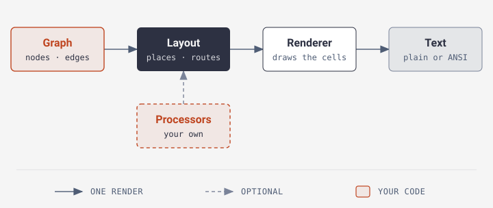

# php-dag

[](https://packagist.org/packages/wazum/php-dag)
[](https://github.com/wazum/php-dag/actions/workflows/ci.yml)
[](LICENSE)

**Draw directed graphs as text, in pure PHP.**

Pipelines, workflows, dependency trees and state machines, drawn with box
characters where you already look: the terminal, a CI log, a Markdown file.

- **Text output anywhere.** No image to open, no Graphviz to install. Unicode
  box drawing by default, plain ASCII when you need it, ANSI colours for the
  terminal.
- **Reads and writes Graphviz DOT.** Pipe `terraform graph` or Symfony's
  `workflow:dump` into the `php-dag` command and get a drawing.
- **Real graphs, not just trees.** Cycles, self-loops, parallel edges, edge
  labels, groups, and left-to-right flow.
- **Pure PHP.** No dependencies, one extension (`ext-mbstring`).

PHP 8.2+ · MIT License


## Install

```bash
composer require wazum/php-dag
```

Already have a DOT file from another tool? Render it straight to text:

```bash
terraform graph | vendor/bin/php-dag --direction=lr
```

## A CI pipeline

```php
use PhpDag\AsciiDag;
use PhpDag\Graph\{Edge, Graph, Node};

$graph = new Graph();
$graph->addNode(new Node('ci', 'CI Pipeline'))
      ->addNode(new Node('lint', 'Lint'))
      ->addNode(new Node('test', 'Unit Tests'))
      ->addNode(new Node('build', 'Build'))
      ->addNode(new Node('deploy', 'Deploy'))
      ->addEdge(new Edge('ci', 'lint'))
      ->addEdge(new Edge('ci', 'test'))
      ->addEdge(new Edge('lint', 'build'))
      ->addEdge(new Edge('test', 'build'))
      ->addEdge(new Edge('build', 'deploy'));

echo AsciiDag::default()->render($graph);
```

```
    ╭─────────────╮
    │ CI Pipeline │
    ╰──────┬──────╯
           │
    ┌──────┴─────┐
    ▼            ▼
╭───┴──╮  ╭──────┴─────╮
│ Lint │  │ Unit Tests │
╰───┬──╯  ╰──────┬─────╯
    │            │
    └──────┬─────┘
           ▼
       ╭───┴───╮
       │ Build │
       ╰───┬───╯
           │
           ▼
      ╭────┴───╮
      │ Deploy │
      ╰────────╯
```

For small graphs, `Graph::fromEdges()` and `connect()` save you the `Node` and
`Edge` objects. See [Building graphs](guide/building-graphs.md).

## How it works

<picture>
  <source media="(max-width: 700px)" srcset="diagrams/how-it-works-narrow.svg">
  
</picture>

1. You build a **graph** of nodes and edges, by hand or from DOT.
2. The **layout** puts the nodes into layers, orders each layer to avoid
   crossings, gives every box a position and routes every edge, in the way
   Graphviz `dot` does.
3. The **renderer** draws boxes, edges and labels onto a grid of cells and
   turns it into plain text or ANSI-coloured text.

The layout is a chain of small processors, and you can add your own or replace
one. [How it works](guide/how-it-works.md) shows every step.

## Guides

| Guide | What you learn |
| --- | --- |
| [Building graphs](guide/building-graphs.md) | Nodes, edges, the shortcuts, asking the graph about its structure, cycles and self-loops, reusing a layout |
| [Styling boxes and edges](guide/styling.md) | Border and stroke styles, multi-line boxes, badges, highlighted paths, colours, ASCII output, spacing |
| [Edge labels](guide/edge-labels.md) | Labels and where they sit |
| [Left-to-right flow](guide/left-to-right.md) | Drawing a graph sideways |
| [Groups](guide/groups.md) | Drawing a border around related nodes |
| [DOT and the command line](guide/dot-and-cli.md) | Reading and writing DOT, the `php-dag` command, Symfony workflows |
| [Customising the layout](guide/pipeline.md) | Layout quality and your own layout processors |
| [Performance](guide/performance.md) | What large graphs cost, with timings |
| [How it works](guide/how-it-works.md) | The three stages and every layout step, plus prior art |

## Support

Bug reports, questions, and feature ideas go to the
[issue tracker](https://github.com/wazum/php-dag/issues). See
[CONTRIBUTING.md](CONTRIBUTING.md) to work on php-dag, and
[SECURITY.md](SECURITY.md) to report a security problem.

## License

MIT. Made by [Wolfgang Klinger](https://www.wolfgang-klinger.dev/).
