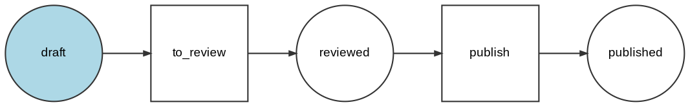

# DOT and the command line

## Reading and writing DOT

Read [Graphviz DOT](https://graphviz.org/doc/info/lang.html) from
`terraform graph`, Symfony's `workflow:dump`, or any other tool:

```php
use PhpDag\AsciiDag;
use PhpDag\Graph\Graph;

$graph = Graph::fromDot('digraph { a -> b [label="ok"]; }');

echo AsciiDag::default()->render($graph);
```

```
╭───╮
│ a │
╰─┬─╯
  │
  │ ok
  ▼
╭─┴─╮
│ b │
╰───╯
```

`$graph->toDot()` turns a graph back into DOT.

The parser reads the common DOT that real tools emit: `strict digraph`,
subgraphs, clusters (imported as groups), default attributes, quoted
identifiers, numeric values (negatives included), HTML-like labels (tags
removed), multi-line labels (`\n`), and comments. Unknown attributes are
ignored. `strict` graphs merge repeated edges; non-strict graphs keep parallel
edges. Self-loops are kept and drawn. Control characters in labels are stripped,
so an untrusted file cannot inject terminal escape sequences.
`PhpDag\Dot\DotParser::flowDirection()` reports the `rankdir`.

These node and edge attributes set the style:

| DOT attribute | Becomes |
|---|---|
| node `style=dashed` / `dotted` | `BorderStyle::Dashed` / `Dotted` |
| node `style=bold` | `BorderStyle::Double` (`penwidth` is not read) |
| node `style=rounded`, `invis`, or none | `BorderStyle::Rounded`, the default |
| node `phpdag_border=solid` / `none` | `BorderStyle::Solid` / `None` (Graphviz has no such style) |
| node `labeljust=l` / `r` | title and body aligned `ContentAlignment::Left` / `Right` |
| node `color`, else `fontcolor` | the node's color |
| edge `color` | the edge's color |

`style` may be a list such as `"rounded,dashed"`; the last border keyword wins.
`invis` is ignored, because php-dag cannot hide a node, and a border-less box
leaves edges no row to attach to: they would draw over the text. Ask for
`phpdag_border=none` to get one anyway. Colors are `black`, `red`, `green`,
`yellow`, `blue`, `magenta`, `cyan`, `white`, and `gray`/`grey` (bright black),
in any case. Other names and `#rrggbb` values are ignored. Graphviz reads
`labeljust` only on graphs and clusters; php-dag reads it on nodes, and any
other value keeps the default (centred title, left-aligned body). Defaults
(`node [style=dashed]`), inside clusters too, apply as usual.

It is a pragmatic subset of the DOT grammar, not a full implementation:
subgraphs used as edge endpoints (`{a b} -> c`), quoted-string concatenation
with `+`, and nested clusters are not supported.

`toDot()` is a Graphviz **visualization export**, not a full serializer. Node
titles and multi-line content, node border styles, edges, edge labels, edge
stroke styles, the colors in the table above, and groups (including their ids
and labels) round-trip through `toDot()`/`fromDot()`. Presentation and layout
hints that DOT does not carry — bright colors other than gray, a body aligned
differently from its title, badges, edge weights, `minLength`, and label positions — are
dropped. Use it to hand a graph to Graphviz or another DOT
tool, not as a save/load format.

## The `php-dag` command

The package ships a `php-dag` binary. It reads a DOT file, or DOT from stdin:

```bash
vendor/bin/php-dag deps.dot
terraform graph | vendor/bin/php-dag --direction=lr
vendor/bin/php-dag --ascii deps.dot > graph.txt
```

The `rankdir` from the file is used automatically; `--direction=tb|lr` overrides
it. Colors are auto-detected (`--ansi` / `--no-ansi` to force). `--node-spacing`,
`--rank-spacing`, and `--quality` work like the builder options. Run
`php-dag --help` for the full list. Syntax errors go to stderr with the line and
column and a non-zero exit code.

## Symfony workflows

Symfony's [`workflow:dump`](https://symfony.com/doc/current/workflow/dumping-workflows.html)
command prints a workflow as DOT. Pipe it to `php-dag` to see the diagram in the
terminal, with no Graphviz install:

```bash
php bin/console workflow:dump blog_publishing | vendor/bin/php-dag
```

The dump looks like this, shortened, and sets `rankdir="LR"`, so `php-dag` draws
it left to right:



```
╭───────╮  ╭───────────╮  ╭──────────╮  ╭─────────╮  ╭───────────╮
│ draft ├─▶┤ to_review ├─▶┤ reviewed ├─▶┤ publish ├─▶┤ published │
╰───────╯  ╰───────────╯  ╰──────────╯  ╰─────────╯  ╰───────────╯
```

Places and transitions both become boxes. Add `--ascii` for plain output, or
`--direction=tb` to force top-to-bottom.
